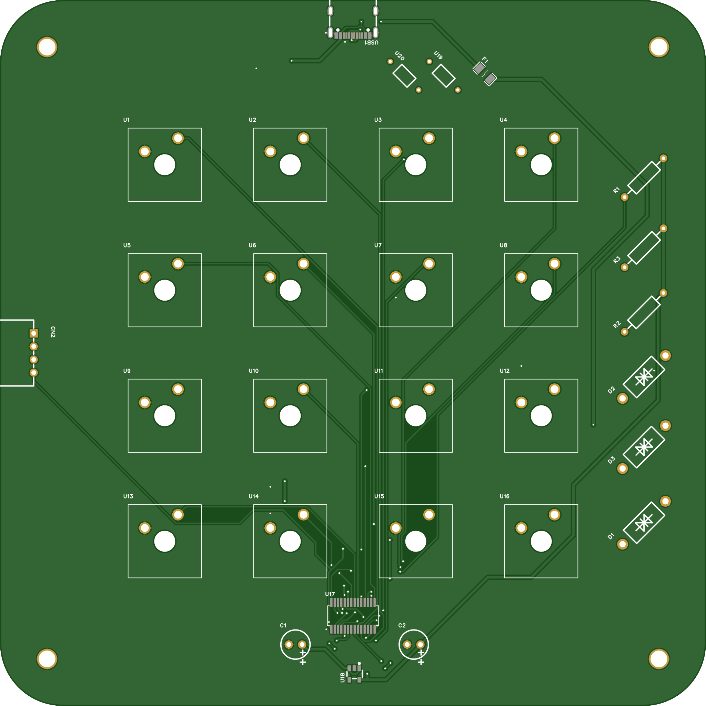
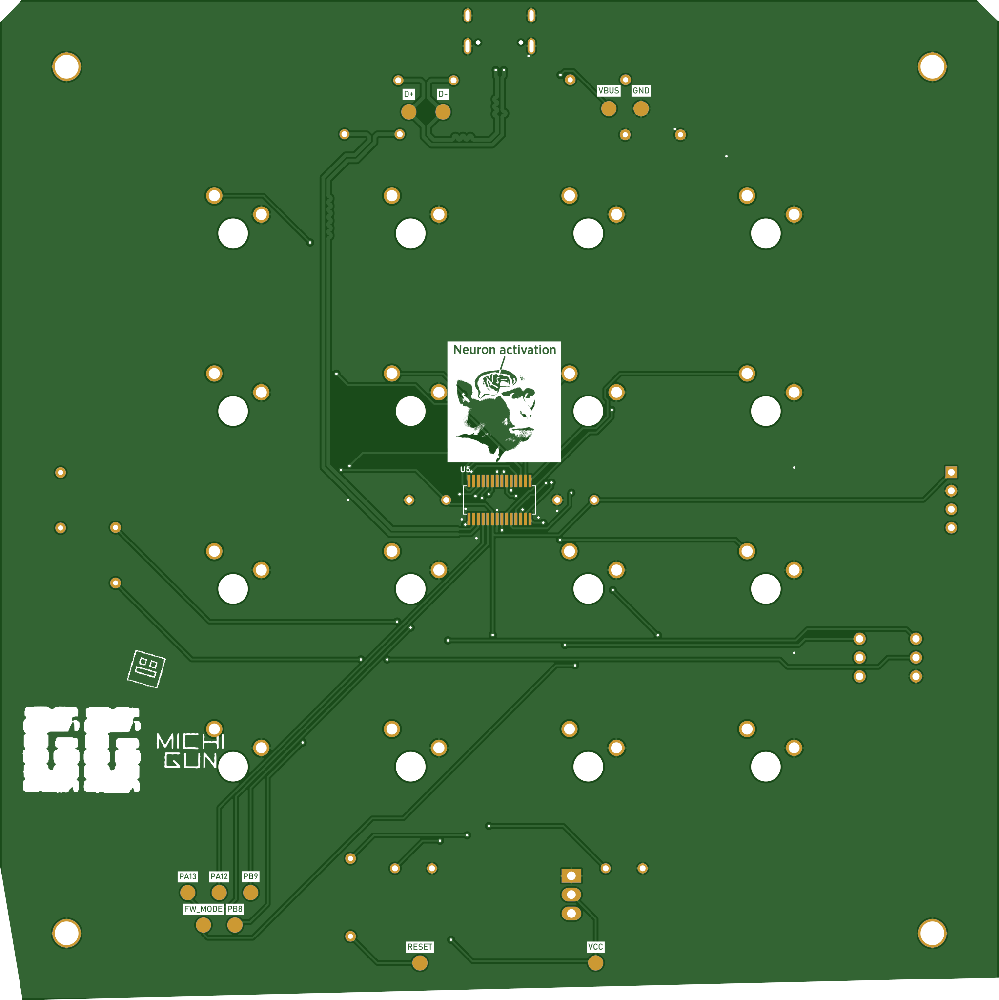
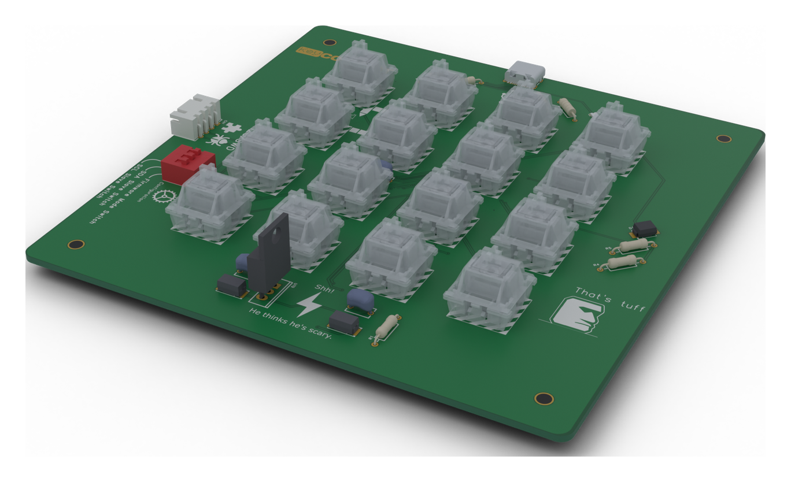
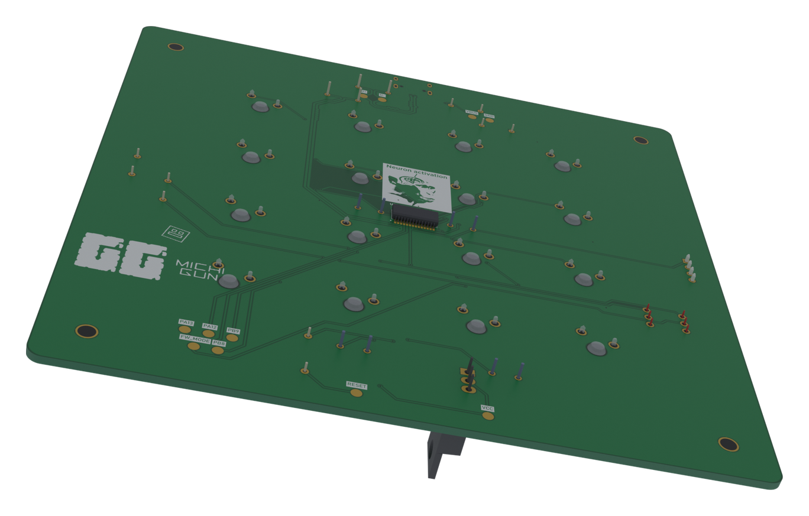

<p align="center">
  <picture>
    <source media="(prefers-color-scheme: dark)" srcset="docs/assets/logo_dark.png">
    
  </picture>
</p>

**An open-source, 16-key mechanical macropad built around the CH32X035 RISC-V MCU.**

KeyConnect is a fully open-source, programmable 16-key macropad designed for
accessibility, cheap hand-assembly, and easy customization. It uses through-hole
parts wherever possible, a fully reprogrammable RISC-V microcontroller, and a
vendor-HID configuration protocol so the keymap can be remapped from your desktop
without any custom driver.

### Top layer

Component placement, signal routing, and switch layout, composited from the
fabrication files in [`hardware/gerbers/`](hardware/gerbers): soldermask, copper
under the mask, exposed pads, silkscreen and drills, clipped to the board outline.
See [`mechanical/pcb/previews/README.md`](mechanical/pcb/previews/README.md) for
how they are generated.



### Bottom layer

Ground plane, power routing, and connector placement. The MCU (U5) and all 11 test
points are mounted on this side. Both flat views use the Gerber coordinate system,
so bottom-side text reads mirrored here — exactly as it does in any fab viewer.



### Assembled board

Fully populated 3D views, rebuilt from the Gerber artwork itself (silkscreen,
soldermask openings and all) with the component bodies taken from the STEP export.
The switch housings are drawn translucent so the silkscreen under them stays
visible, and the DIP switch is picked out in red.





## Features

- **16× Cherry MX switches** in a 4×4 grid, 24 mm pitch
- **CH32X035G8R6 RISC-V microcontroller** (48 MHz, QSOP-28) — fully
  reprogrammable over USB
- **USB Type-C** connectivity with an SMBJ5.0A TVS diode and a 500 mA fuse
- **I2C expansion header** (XH 2.54 mm, 4-pin) — add an LCD/OLED, RGB controller,
  or rotary encoder; the board can also act as an I2C peripheral
- **Mode slide switch** — selects I2C slave role / firmware bootloader entry
- **Remappable keymap** stored in flash, editable over HID feature reports
- **Mostly through-hole** — only 6 SMD parts (MCU, USB-C, TVS diode, fuse, and
  two bulk capacitors)
- **Low-cost build** — under \$20/unit with Gateron switches, under \$40 with
  genuine Cherry MX
- **2-layer PCB** with proper ground planes and **11 test points**

## Technical specifications

| | |
|---|---|
| Microcontroller | CH32X035G8R6 (RISC-V `rv32imac`, 48 MHz, QSOP-28) |
| Power | USB 5 V input, 3.3 V LDO (LM1117T-3.3, TO-220) |
| Connectivity | USB 2.0 Full Speed, I2C (master/peripheral) |
| Protection | SMBJ5.0A TVS diode, 500 mA / 24 V fuse |
| PCB | 2-layer FR-4, 1.6 mm, 135 mm × 135 mm, 3 mm corner radius |
| Assembly | 47 placements, 6 of them SMD |
| USB IDs | VID `0x2709` / PID `0x0001` (HID keyboard) |

## Repository layout

```
.
├── docs/            OSHWLab project write-up + logo assets
├── firmware/        CH32X035 firmware + Windows host tools   (MIT)
│   ├── main.c
│   ├── driver/      keyconnect.inf, config protocol, CLI + WinUI 3 GUI
│   └── prebuilt/    known-good main.bin / main.elf / main.map
├── hardware/        PCB + schematic sources and fab files     (CC BY-SA 4.0)
│   ├── pcb/         PCB2_1.pcbdoc
│   ├── schematic/   EasyEDA schematic sheets + exported netlist
│   ├── gerbers/     Gerber / drill / flying-probe export
│   ├── bom/         BOM with LCSC part numbers (CSV + Markdown)
│   └── exports/     STEP / DXF / DWG / OBJ 3D models
└── mechanical/      3D enclosure + board previews             (CC BY-SA 4.0)
```

## Fabrication files

Everything needed to get a board made and populate it lives under
[`hardware/`](hardware):

| Artifact | Location | Notes |
|---|---|---|
| Gerbers + drills | [`hardware/gerbers/`](hardware/gerbers) | EasyEDA Pro export, 2026-10-18; see the [layer map](hardware/gerbers/README.md) |
| Bill of materials | [`hardware/bom/BOM_PCB2_1.csv`](hardware/bom/BOM_PCB2_1.csv) | 15 line items, LCSC part numbers + datasheets |
| Interactive BOM | [`hardware/bom/InteractiveBOM_PCB2_1_2026-10-18.html`](hardware/bom) | Self-contained viewer with a 3D view; open it in a browser |
| Netlist | [`hardware/schematic/Netlist_PCB2_1_2026-10-18.tel`](hardware/schematic/Netlist_PCB2_1_2026-10-18.tel) | pad-level connectivity |
| 3D model | [`hardware/exports/3D_PCB2_1_2026-10-18.step`](hardware/exports) | STEP assembly: board + the 36 component bodies |
| PCB source | [`hardware/pcb/PCB2_1.pcbdoc`](hardware/pcb) | EasyEDA Pro |
| Schematics | [`hardware/schematic/`](hardware/schematic) | EasyEDA Pro `.schdoc` sheets |

### Bill of materials

| Designators | Qty | Value / Part | Footprint | LCSC | Mfr Part # |
|---|---|---|---|---|---|
| `C1 C2 C4 C5` | 4 | 100nF | CAP-TH_L5.8-W3.6-P5.0-D0.6 | [C5632426](https://www.lcsc.com/product-detail/C5632426.html) | 178MU0002 |
| `C3 C6` | 2 | 47µF | CAP-SMD_L6.0-W3.2-R-RD | [C506634](https://www.lcsc.com/product-detail/C506634.html) | 593D476X9010C2TE3 |
| `CN1` | 1 | XH 2.54 mm 4-pin | CONN-TH_4P-P2.50_ZX-XH2.54-4PWZ | [C7429643](https://www.lcsc.com/product-detail/C7429643.html) | ZX-XH2.54-4PWZ |
| `D1` | 1 | SMBJ5.0A | SMB_L4.6-W3.6-LS5.4-RD | [C50087807](https://www.lcsc.com/product-detail/C50087807.html) | SMBJ5.0A |
| `F1` | 1 | 500mA/24V | F1206 | [C2984676](https://www.lcsc.com/product-detail/C2984676.html) | 500mA/24V |
| `R1` | 1 | 10kΩ | RES-TH_BD2.3-L6.5-P10.50-D0.5 | [C119347](https://www.lcsc.com/product-detail/C119347.html) | MF1/4W-10KΩ±1% T |
| `R2 R3` | 2 | 22Ω | RES-TH_BD2.4-L6.3-P10.30-D0.6 | [C1365706](https://www.lcsc.com/product-detail/C1365706.html) | CFR-25JB-52-22R |
| `R4 R5` | 2 | 4.7kΩ | RES-TH_BD2.3-L6.5-P10.50-D0.5 | [C119339](https://www.lcsc.com/product-detail/C119339.html) | MF1/4W-4.7KΩ±1% T |
| `R_CC1 R_CC2` | 2 | 5.1kΩ | RES-TH_BD2.3-L6.5-P10.50-D0.5 | [C714010](https://www.lcsc.com/product-detail/C714010.html) | MF1/4W-5.1KΩ±1%T52 |
| `SW1` | 1 | DSWB03LHGET | SW-TH_DSWB03LHGET | [C99420](https://www.lcsc.com/product-detail/C99420.html) | DSWB03LHGET |
| `U1–U4, U6–U17` | 16 | Cherry MX switch | CherryMX_9.75u | — | user-supplied |
| `U5` | 1 | CH32X035G8R6 | QSOP-28_L9.9-W3.9-P0.64-LS6.0-BL | [C49118551](https://www.lcsc.com/product-detail/C49118551.html) | CH32X035G8R6 |
| `U19` | 1 | LM1117T-3.3 | TO-220-3_L10.0-W4.5-P2.54-L | [C498321](https://www.lcsc.com/product-detail/C498321.html) | LM1117T-3.3 |
| `USB1` | 1 | Type-C 16-pin | USB-C-SMD_TYPE-C16PIN | [C393939](https://www.lcsc.com/product-detail/C393939.html) | TYPE-C16PIN |
| `GND D+ D- VCC VBUS RESET PA12 PA13 PB8 PB9 FW_MODE` | 11 | Test point 0.5 mm | Test-Point-0.5mm | — | — |

Full table with manufacturers, JLCPCB part classes, and datasheet links:
[`hardware/bom/BOM_PCB2_1.csv`](hardware/bom/BOM_PCB2_1.csv).

## Firmware

The firmware targets the CH32X035 and is built with
[ch32fun](https://github.com/cnlohr/ch32fun) and the RISC-V GCC toolchain.
A known-good `main.bin` / `main.elf` is committed under `firmware/prebuilt/`,
so you can flash a board without building anything.

Highlights: 16-key debounce, USB HID keyboard reports, flash-backed keymap,
a HID feature-report config protocol (Report IDs `0x01`–`0x04`), an optional
I2C LCD, and a `PB12` bootloader entry.

See **[`firmware/README.md`](firmware/README.md)** for build, flash, pinout, and
the full configuration protocol.

### Host configuration tool

`firmware/driver/` contains an INF for a proper Windows device name, a `hidapi`
CLI (`keyconnect-config`), and a **WinUI 3 desktop app** that shows the 4×4 grid,
edits mappings, and saves them to flash.

## Applications

- Programmable macro shortcuts for productivity
- Custom gaming keypad
- Video-editing hotkeys
- CAD / design software shortcuts
- MIDI controller for music production
- An educational platform for learning PCB design

## Status

| | |
|---|---|
| PCB design | ✅ Complete (Rev 0.2) |
| Schematic | ✅ Verified |
| Gerbers / drills | ✅ Exported 2026-10-18 |
| BOM (LCSC part numbers) | ✅ Published in `hardware/bom/` |
| Firmware | ✅ Source available (`firmware/`) |
| Host configurator | ✅ CLI + WinUI 3 GUI source |
| 3D case | ⏳ In development |

### Known issues

- On the current board the `PA7` and `PB0` traces are shorted, so the physical
  keys that use them (`H` and `I`) report the same keycode. See
  [`firmware/README.md`](firmware/README.md) for details.

## Future ideas

The I2C expansion port makes add-ons straightforward: per-key RGB (WS2812B),
an OLED status display, a rotary encoder, alternative case variants, and
possibly a QMK/Vial port.

## License

KeyConnect is released under two licenses:

- **Firmware and host software** (`firmware/`) — **MIT** — see [`LICENSE`](LICENSE)
- **Hardware design files** (`hardware/`, `mechanical/`, `docs/`) — **CC BY-SA 4.0** — see [`LICENSE-hardware`](LICENSE-hardware)

## Author

**Logmanbay** — [@logman00b44](https://github.com/logman00b44)

Rendered project write-up: [`docs/OSHWLab_readme.md`](docs/OSHWLab_readme.md)
